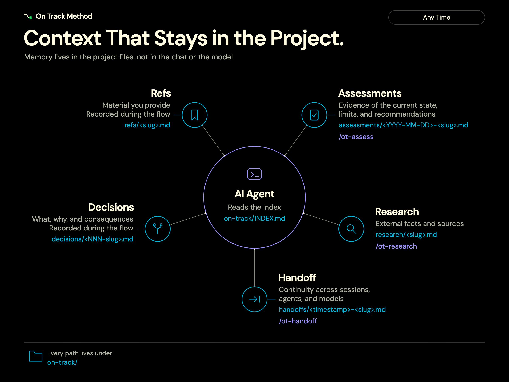

# Quick start

This page gets On Track Method running in a project and shows the whole method in three diagrams. Each section links to the page with the full rules.

## Install and start

You need Node.js 22.20 or later, `npx`, Git, Bash, and a coding agent that supports skills.

From the root of your project, install all eight skills:

```bash
npx skills add jotafurtado/on-track --skill '*'
```

Open your agent in the same project and initialize the method:

```text
/ot-init
```

This creates the `on-track/` folder, the artifact index, and the managed block in `AGENTS.md`. Running it again duplicates nothing.

Then start a change with a concrete request:

```text
/ot-intent Add password recovery by email.
Do not change the social login.
```

Replying `.` at each stop moves the track to the next stage, so you do not need to call each skill yourself. [Installation](installation.md) covers the options and the checkout installer; [Your first track](first-track.md) walks one request from intent to ship.

The examples use the Claude Code call, `/ot-intent`. In Codex, use `$ot-intent` or the `/skills` picker. In other harnesses, ask `Use the ot-intent skill to <goal>`.

## How a request travels


- **Express**: a small, reversible edit that meets five criteria, such as at most three files and one check that verifies it. The agent implements it, runs the check, leaves a local note called a crumb for your commit, and reports, with no track and no stop.
- **Highway**: every other edit, and the default. The agent writes an intent, then a spec and tasks, then implements and offers ship, stopping for your signal after each stage.
- **Off Road**: the consulted way onto the Highway, for terrain you do not know yet. The intent and spec questions also carry the design choices the agent would otherwise settle alone, until the spec is approved.

Your explicit choice of lane always wins. The criteria are in [Request classes](../reference/request-classes.md).

## The Highway


At the end of each Highway stage the agent shows a four-bullet summary and the artifacts it wrote, then waits for your signal as plain text:

- **Green**: `.`, or a message that only means proceed, moves the same track to the next stage.
- **Red**: `x`, or a message that only means stop, halts without changing any status, deleting files, or undoing code.
- **Yellow**: any other reply is an instruction to the current stage, which revises and shows the summary again.

Ship marks the track as done; it never commits, pushes, or deploys. See [Highway signals](../guides/highway-signals.md).

## Context that stays in the project



| Artifact | What it preserves | Where it lives |
|---|---|---|
| **Ref** | Material you supply, such as a URL, a document, or an external code snippet that grounds the change. | `on-track/refs/<slug>.md` |
| **Research** | External facts, alternatives, and the sources the agent consulted. | `on-track/research/<slug>.md` |
| **Assessment** | Evidence about the current state of what was evaluated, with limitations and recommendations. | `on-track/assessments/<YYYY-MM-DD>-<slug>.md` |
| **Decision (ADR)** | What was decided, why, and what the choice implies. | `on-track/decisions/<NNN-slug>.md` |
| **Handoff** | The context needed to continue in another session, agent, or model. | `on-track/handoffs/<timestamp>-<slug>.md` |

Research, assessments, and handoffs can be requested at any time without starting a change. See [Supporting artifacts](../guides/supporting-artifacts.md).

## Commands

| Group | Command | When to use |
|---|---|---|
| **Setup** | `/ot-init` | When adopting the method in a project. Prepares the structure and the index. |
| **Development, in this order** | `/ot-intent` | Starts a Highway change: records the problem, expected outcome, scope, and limits. |
| | `/ot-spec` | After the intent: writes the spec and the tasks for your review and approval. |
| | `/ot-implement` | After the approved plan: implements the tasks, validates the results, and reviews the delivery. |
| **Support, any time** | `/ot-research` | Researches external facts, documentation, or alternatives with traceable sources. |
| | `/ot-assess` | Evaluates what already exists, with evidence, limitations, and recommendations. |
| | `/ot-handoff` | Records the context to continue in another session, agent, or model. |
| | `/ot-doctor` | Checks the project after a package update and repairs it once you confirm. |

Every command is described in [Commands](../reference/commands.md).
